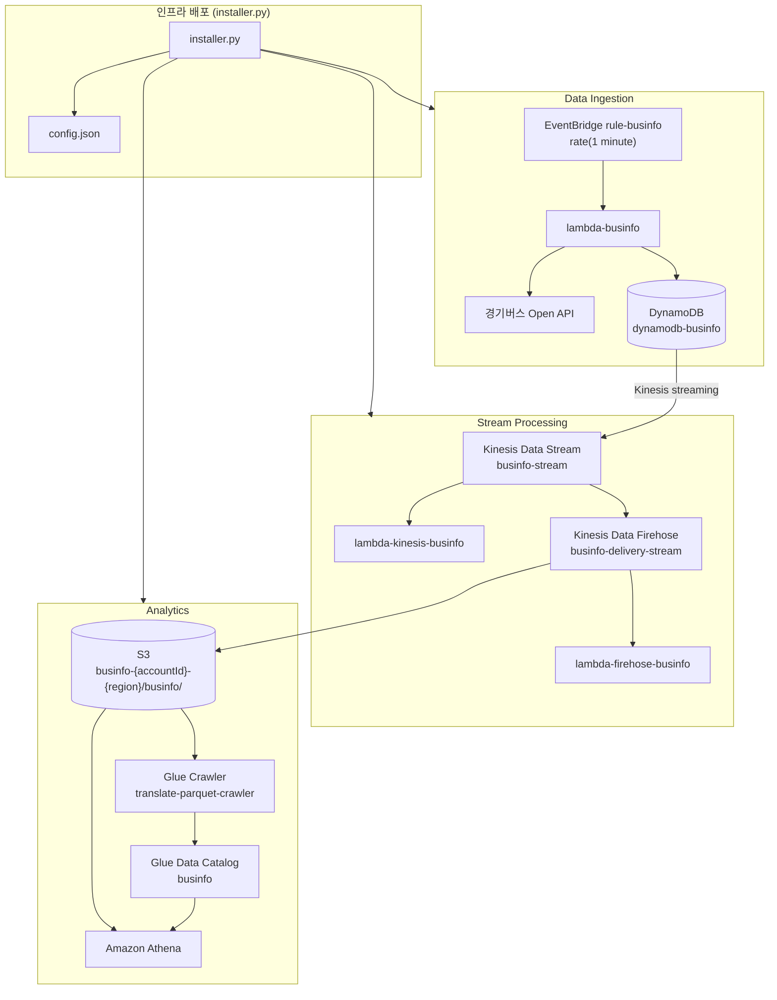

# Amazon Serverless를 이용한 실시간 버스 정보 수집 및 저장

여기에서는 버스 정보를 주기적으로 수집하여 분석할 수 있도록, Amazon Serverless인 [Amazon Kinesis Data Stream](https://github.com/kyopark2014/technical-summary/blob/main/kinesis-data-stream.md), [Kinesis Data Firehose](https://github.com/kyopark2014/technical-summary/blob/main/kinesis-data-firehose.md), Lambda, DynamoDB, S3를 이용합니다. 인프라는 boto3 기반의 `installer.py` / `uninstaller.py`로 생성·삭제합니다. (`cdk/lib/cdk-stack.ts`는 참고용 IaC 정의이며, 실제 배포는 CDK 대신 boto3 스크립트를 사용합니다.)

## 문제 정의

"센터필드 정류장에서 얼마나 오래 기다려야 버스를 탈 수 있을까?" 

센터필드 정류장에는 다양한 버스들이 도착하는데, 이 버스들을 타기 위해 탑승객들이 얼마나 기다리는지 알고 싶다는 요구가 있다고 가정합니다. 버스를 기다리는 시간은 버스회사에서 알려주는 예상 도착 시간이 있으나, 출퇴근 트래픽이 극심한 센터필드 버스 정류장은 버스 도착 시간이 예상 도착시간보다 더 오래 걸리기도 합니다. 버스 도착 예상시간의 변화를 분석하면, 현재의 트래픽에 따른 버스의 지연시간을 예측할 수 있고, 전날 또는 평일/주말을 비교하면, 좀 더 정확한 예측이 가능합니다. 

여기서는 버스 도착 시간에 대한 구체적인 예측이 가능하도록, 센터필드 버스 정류장에 도착하는 버스 정보를 수집하여 저장 합니다. 이를 통해, 현재 문제에 대한 구체적인 수치를 확보하고, 향후 문제를 풀때 필요한 각종 데이터를 확보할 수 있습니다. 

## Architecture 구성 

전체적인 구현 Architecture는 아래와 같으며, 데이터를 저장하는 Data Ingestion 부분과 수집된 데이터를 분석에 맞도록 가공하는 Analytics로 크게 나누어지며, 인프라 관리를 위한 `installer.py` / `uninstaller.py`와 로깅을 위한 Amazon CloudWatch로 구성됩니다. 여기서, Amazon Lambda가 수집한 데이터를 Amazon DynamoDB에 저장하고, 이때 발생한 event를 stream 형태로 Kinesis Data Stream이 가져가 필요한 데이터로 가공합니다.

아래의 Data Ingestion에 해당하는 Amzaon Lambda와 Amazon DynamoDB 조합은, 필요시 다른 API를 이용해 DynamoDB에 저장된 이력들을 조회 가능하도록 구현하였으나, 이련 용도 없이 단순히 데이터 수집 용도로만 사용시에는 DynamoDB 없이 Lambda로 부터 Amazon Kinesis Stream을 통해 바로 데이터를 수집 할 수 있습니다. 


주요 사용 시나리오는 아래와 같습니다.

1. EventBridge를 통해 Cron job 형태로 Lambda가 Centerfied 버스정류장에 도착하는 버스정보를 정기적으로 조회하여 DynamoDB에 저장합니다. 

2. DynomoDB에 INSERT되는 이벤트를 Kinesis Data Stream으로 전달합니다.

3. Kinesis Data Stream이 Queue형태로 저장한 데이터를 Kinesis Data Firehose가 받아서, 분석에 적합하도록 데이터를 변환 합니다.

4. 변환된 데이터를 분석이 용이하도록 AWS Glue Data Catalog를 이용해 parquet 형식으로 변환하여, S3에 저장합니다.
 
5. S3에 저장된 데이터는 Amazon Athena를 통해 읽고 분석합니다. 

### Operation Architecture



| 단계 | 리소스 / 코드 | 설명 |
|------|---------------|------|
| **1. 수집** | `rule-businfo` → `lambda-businfo` | 1분 주기로 센터필드 정류장 버스 도착 정보를 Open API에서 조회해 DynamoDB에 저장 |
| **2. 스트리밍** | `dynamodb-businfo` → `businfo-stream` | DynamoDB 변경 이벤트를 Kinesis Data Stream으로 전달 |
| **3. 모니터링** | `lambda-kinesis-businfo` | 스트림 데이터를 실시간 확인·추가 처리 (선택) |
| **4. 변환·적재** | `businfo-delivery-stream` + `lambda-firehose-businfo` | Firehose가 스트림을 읽고 버스 필드만 추출해 S3 `businfo/` prefix에 저장 |
| **5. 카탈로그** | `translate-parquet-crawler` | Glue Crawler가 S3 데이터를 스캔해 `businfo` 테이블 메타데이터 생성 |
| **6. 분석** | Amazon Athena | Glue Catalog / S3 데이터를 SQL로 조회·분석 |
| **배포·삭제** | `installer.py` / `uninstaller.py` | boto3로 위 리소스를 생성·삭제하고 결과를 `config.json`에 기록 |


## 버스 도착 정보 조회

경기버스 노선정보는 [버스정보조회](https://github.com/kyopark2014/data-analytics-for-businfo/blob/main/bus-info.md) 를 이용하여 읽어올 수 있습니다. 


## 주기적인 버스 정보 수집

`installer.py`가 EventBridge 규칙 `rule-businfo`를 생성하여 1분 주기로 [Lambda for businfo](cdk/repositories/lambda-businfo/index.js)를 실행합니다. Lambda는 Bus Open API를 호출하여 DynamoDB에 저장합니다.

```bash
# installer.py가 생성하는 EventBridge 스케줄
rate(1 minute) → lambda-businfo
```

## Amazon Kinesis Data Stream로 수집되는 정보 

Amazon Kinesis Data Stream으로 수집된 정보를 Queue처럼 Shard에 저장 합니다. 저장된 스트림 데이터는 필요한 서비스들이 호출하여 사용할 수 있는데, 여기서는 Amazon Kinesis Data Firehose 이외에도 [Lambda for Kinesis](https://github.com/kyopark2014/data-analytics-for-businfo/blob/main/lambda-kinesis.md)를 이용해 스트림 데이터의 데이터를 모니터링 하고 필요시 추가적인 데이터를 수집합니다. 

## Amazon Kinesis Data Firehose로 전달된 데이터를 Lambda로 변환

Amazon Kinesis Data Firehose에 전달된 데이터는 DynamoDB에 INSERT 이벤트 정보이므로, 버스에 대한 정보 이외에도 DynamoDB에 대한 이벤트 정보가 포함되어 있습니다. 버스에 대한 정보만을 [Lambda for Firehose](https://github.com/kyopark2014/data-analytics-for-businfo/blob/main/lambda-firehose.md)을 이용하여 추출하는 변환 작업을 합니다.

## Parquet 로 형식 변환 

연속적으로 Amazon Kinesis Data Stream으로 수집된 정보를 Amazon S3에 저장 후 활용하기 위해서, 저장하는 용량이나 성능에서 유용한 parquet로 변환하고자 합니다. 

이를위해 Amazon Glue Data Catalog 기능인 Crawler를 이용해, Table을 생성하고, Amazon Kinesis Fiehose에서 Parquet 변환을 합니다.

## Athena Work Group 설정

Athena Work Group(`businfo-workgroup`)은 분석 시 Console에서 별도 생성할 수 있습니다. S3 결과 경로는 `config.json`의 `s3Path`를 사용합니다.

## 인프라 생성 및 삭제

기존 AWS CDK(`cdk deploy`) 방식은 boto3 기반 `installer.py`로 대체하였습니다. `ref/installer.py`와 동일한 패턴으로 리소스를 순차 생성하고, 배포 결과를 `config.json`에 기록합니다.

### 사전 요구 사항

| 항목 | 버전/설명 |
|------|-----------|
| Python | 3.9 이상 |
| boto3 | AWS SDK for Python |
| AWS CLI 자격 증명 | `aws configure` 또는 환경 변수 |
| Node.js / npm | `lambda-businfo` 패키징 시 필요 (`installer.py` 실행 시 자동 설치) |
| Lambda 런타임 | `nodejs20.x` |

```bash
pip install boto3
```

### installer.py / uninstaller.py

`installer.py`는 `cdk/lib/cdk-stack.ts`에 정의된 AWS 리소스를 boto3로 생성합니다. 배포가 완료되면 생성된 리소스 정보가 프로젝트 루트의 `config.json`에 저장됩니다.

**생성되는 주요 리소스**

| 리소스 | 이름 |
|--------|------|
| S3 Bucket | `businfo-{accountId}-{region}` |
| Kinesis Data Stream | `businfo-stream` |
| DynamoDB Table | `dynamodb-businfo` |
| Lambda | `lambda-businfo`, `lambda-kinesis-businfo`, `lambda-firehose-businfo` |
| EventBridge Rule | `rule-businfo` (1분 주기) |
| Glue Database / Crawler | `businfo` / `translate-parquet-crawler` |
| Kinesis Data Firehose | `businfo-delivery-stream` |

**인프라 생성**

```bash
python3 installer.py
python3 installer.py --region ap-northeast-2
python3 installer.py --debug
```

**인프라 삭제**

`uninstaller.py`는 `installer.py`로 생성한 리소스를 의존성 역순으로 삭제하고, `config.json`을 정리합니다. 삭제 후 `deploymentStatus`가 `uninstalled`로 기록됩니다.

```bash
python3 uninstaller.py
python3 uninstaller.py --yes
python3 uninstaller.py --region ap-northeast-2 --yes
```

`config.json`에 `bucketName` 등이 저장되어 있으면 재실행·삭제 시 해당 값을 우선 사용합니다.

**배포 후 작업**

`installer.py`로 deploy하면 `lambda-businfo`가 schedule에 따라 자동으로 실행되어 버스 도착 정보를 수집합니다. 초기에는 parquet 변환이 비활성화되어 있으므로, 수집된 데이터는 S3 bucket에 json 포맷으로 저장됩니다.


json 파일이 수집된 후 [Table 생성(Crawler)](run-crawler.md)을 참조하여 crawler를 실행해 변환용 table을 생성합니다.

table이 생성되면 [Deploy 추가 사항](enable-format-translation.md)을 참조하여 parquet 변환을 시작합니다.

### 참고: Console / CDK

- **Console**: 수동 구성 가이드는 [console/Readme.md](console/Readme.md)를 참고하세요.
- **CDK**: `cdk/` 디렉터리의 스택 정의는 참고용이며, 신규 배포에는 `installer.py`를 사용합니다.

## 시험 및 결과

`installer.py`로 인프라를 deploy하면 Cron Rule에 따라 Lambda가 정기적으로 버스의 실시간 정보를 조회하여 DynamoDB에 저장하고 Amazon Kinesis를 통해 S3에 저장됩니다. Parquet 변환을 활성화하면 분석에 적합한 형식으로 저장됩니다. Amazon S3에 저장된 버스 정보는 아래와 같이 확인할 수 있습니다.


Athena로 조회한 Table 정보는 아래와 같습니다. 


Athena 조회시 아래와 같이 S3에 csv, meta 파일을 생성됨을 확인 할 수 있습니다.


아래는 생성된 csv에 저장된 데이터의 예 입니다. 


## Case Study: 예상 도착 시간의 오류

Centerfield 버스정류장에서 1분단위로 데이터 수집하였다면, timestamp로 sorting시 예상 도착 시간(predicttime)은 1분 Gap으로 변경되었을것으로 예측되나, 실제로는 아래처럼 일정시간동안 변경이 없는 구간이 있습니다. 해당 시점에 트래픽으로 버스가 이동을 못했을 수도 있고, 잠시 정류장에서 대기 하였을 수도 있는데, Centerfield 정류장에서 대기중인 탑승 예정자는 이유도 모르고 더 오랜 시간을 대기해야 했을것으로 보여집니다. 만약 주중 5시부터 8시까지 트래픽이 주기적으로 발생해서 더 오랜 시간이 걸린다거나, 특정 버스 노선은 특정 구간에서 항상 지연이 크게 발생한다면, 이를 많은 데이터를 통해 분석을 하면 예상되는 버스 도착 시간을 좀 더 정확히 알려줄 수 있을것으로 보여집니다.


## Case Study: 구간별 시간차

마찬가지 1분단위로 측정하였지만, 1)의 경우에는 4분, 2)의 경우에는 2분정도로 빠르게 예상 도착 시간이 줄어들다가 3)부터는 다시 1분 간격으로 변경되고 있습니다. 이와같이 버스정보 API로 제공되는 도착정보는 어떤 패턴을 가지고 실제와 맞지 않음을 알 수 있습니다. 이 경우에 대략 10분 정도 버스가 빨리 도착하였으므로, 1)에서 23분이 남았다고 생각하여 천천히 이동해서, 20분쯤 후에 Centerfield 버스 정류장에 도착하였다면 이미 버스는 지나갔음을 알 수 있습니다.  


